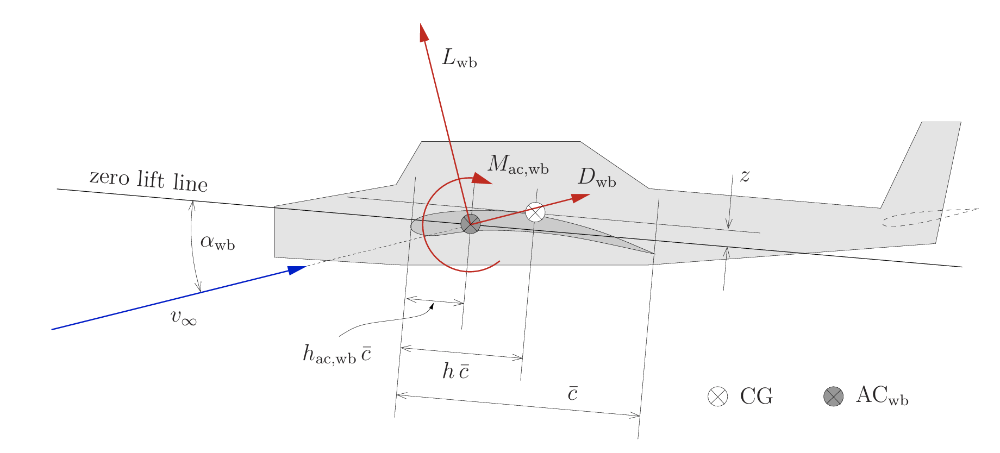
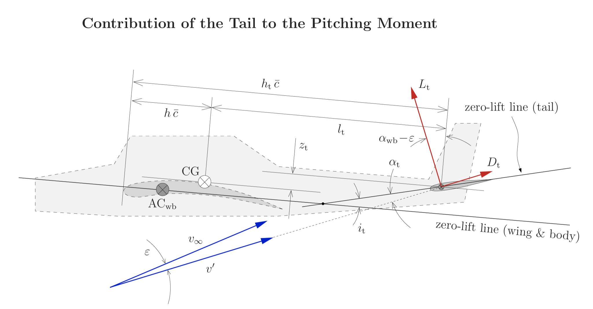
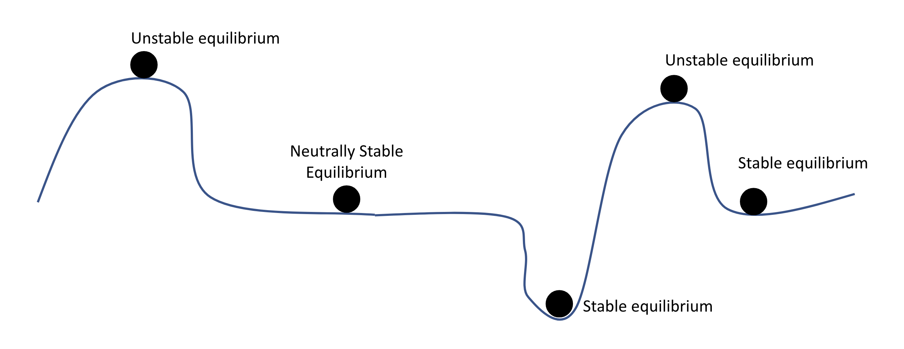
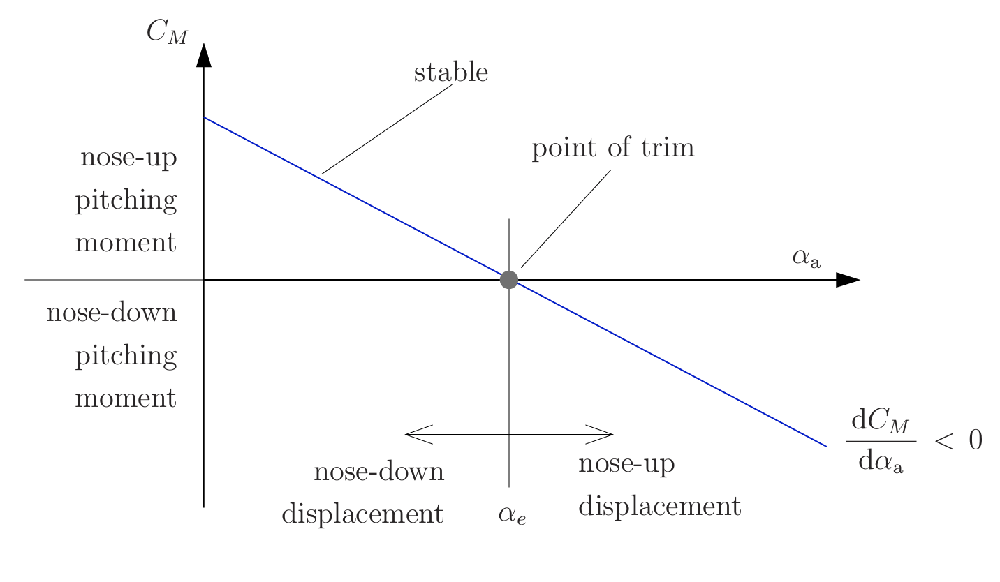
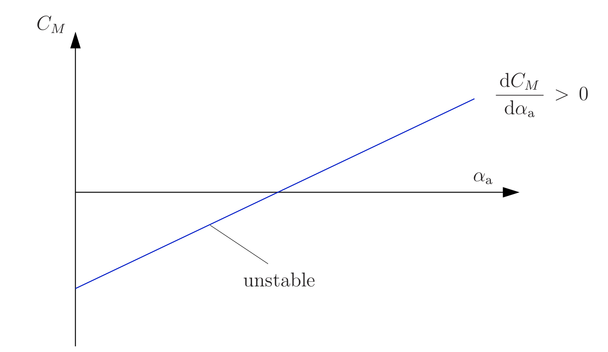

# Outline
- Introduction - one slide
    - Nick Cramer Introduction on one side
        - Start with Dr. Nick Image from the Simpsons - remove the image before the next bullet
        - Go to outline of the lower 48 US states with Flint, MI highlighted with a kettering blue star, show the Kettering University logo and my undergraduate B.S. degrees in Mechanical and Electrical Engineering underneith.
        - Add an arrow that points to Santa Cruz, CA highlighted with a UCSC bannana slug yellow star, show the Univeristy of California, Santa Cruz logo and my PhD in Computer Engineering and under that "Robotics and Control"
        - Add an tiny arrow pointing to NASA Ames Research Center at Moffett Field, CA with a NASA blue star, show the NASA Ames logog
        - Add a tiny arrow pointing to Fremont, CA with a Supernal Aero green star, show Supernal logo
        - Add a tiny arrow pointing to Mountain View, CA with a Wisk Aero yellow star, show Wisk logo
    - QR Code with link to the slides on the other side
- What we are covering today?
    - Split the page into two haves the first will have the question: "Have you ever made a paper air plane just pitch up then fall right to the ground when you throw it?" at the top then on a progression it will go to the animation below
        - Add animation of a paper airplane pitching up stalling and falling
        - Below the animation "The cause might have been longitudinal static stability"
    - Then the progression into the topics point by point
    - Topics:
        - Review
        - Longitudinal Forces
        - Stability
        - Longitudinal Static Stability
- Review
    - Coordinate system
        - Interactive body axis Forward, Right, Down. Axial forces and moments. Include a little table to help define and diagram - Similar to  https://www.aircraftflightmechanics.com/StaticStability/Angles.html#aerodynamic-angles but instead of a fighter jet have a
    - Aerodynamic Angles
        - Wind speed, alpha, beta decomposition. Similar to https://www.aircraftflightmechanics.com/StaticStability/Angles.html#aerodynamic-angles but instead of a fighter jet model have a civilian aircraft.
- Wing Contribution to Longitudinal Forces - Us an image similar to the wing contributions example.  At each progression components will get added. When we get to thrust there should be an imaginary engine added. Ideally the outline should be something like a honda jet.

    

    - Weight - mark and note the center of gravity, show the weight vector
    - Lift - Add lift and drag vector on the same click then project the  lift vector into the vertical axis equal and opposite to the weight. Pop up a call out box that says "Assume Lift is equal to Weight and we are in steady flight" Then on the next click remove it, the lift project, and the weight vector leaving only Lift and Drag vectors.
    - Drag
    - Pitching Moment around the airfoil
    - Thrust
    - After the weight vector is removed as each new one is added we will add a contribution to the Moment around C.G calculation $M_{c.g.,w} = M_{ac}(\alpha) + L(\alpha)*d_{c.g.,L} + D(\alpha)*d_{c.g.,D} + T*d_{c.g.,T}$ where $M_{ac}$ is the moment around the aerodynamic center of the wing, $L$ is the lift vector, $d_{L,c.g.}$ is the orthogional distance between the lift vector and the c.g., $d_{c.g.,D}$ is the orthogional distance between the Drag vector and the c.g., and T is the thrust vector, and $d_{c.g.,T}$ is the orthogional distance between the thrust vector and the c.g.

    - Control surfaces - When we get to control surfaces there should be a flap that animates down and the lift and drag vectors each increase. When the animation happens the lift and drag vectors should increase with them being rotated slightly. The previous vectors should stay but should be made slightly transparent then there should be another vector between the tip of the previous lift vector and to the tip of the new lift vector and it should be labeled $L_{\delta}$ The equations then should be updated so that it reads $M_{c.g.,w} = M_{ac} + L(\alpha, \delta)*d_{c.g.,L} + D(\alpha, \delta)*d_{c.g.,D} + T*d_{c.g.,T}$
- Tail Contributions to Longitudinal Forces - 

    

    - Lift - the same approach to the wing contributions but with the tail. $M_{c.g,t} = L_t(\alpha)*d_{c.g.,L_t} + D_t(\alpha)*d_{c.g.,D}$
    - Drag
    - Control Surface - Take the same approach as in the wing but with the tail subscript.
- Calculating Total Pitching Moment
    - Image of the aircraft from the wing contributions
    - Add each of the force vectors while updating the moment equation starting with $M_{c.g.} = M_{c.g.,w} + M_{c.g.,t}$ then subsituting the whole equations from the previous slides.
- What happens if the forces are not balanced?
    - This is going to be an interactive javascript application that will be embedded into the slide. It should have the outline of the aircraft from the previous slides and a drag and dropable center of gravity marker. There should be a Lift versus angle of attack for the wing and the tail. Assume the tail is a NACA 0012 and that the primary wing as a NACA 4412. Make the reynolds number, air speed and surfrace area roughly equivilant to the displayed aircraft (Honda Jet) The values should be displayed on the screen. There should be a play button where once the user has placed the C.G. where they want it they can hit play at that point an animation will start and it will show the total moment and will animate the pitching direction the aircraft will move in. We are going to assume that the wind speed comes directly in left to right and that the wings are perfectly level with the water line. There should be a little marker on each of the lift curves that update as the animation updates showing how much lift is being generated. The animation should play until the pitch reaches 20 degrees or a timeout is reached. The pitch values should be updating while the animation is running.
- What is stability?
    - Start with a system $\dot{x}(t) = f(x(t))$ that has a unique solution $x(t_0) = x_0$
        - The definition "Equilibrium state: A state $x_e$ is in equilibrium if $\dot{x}_e$ is zero in the absense of all inptus and disturbances.
        - which means, $f(x_e)=0, for all t \leq 0$
- Stability
    - Stable pendulum - Helf the slide will have the definition of stable then the other half the animation of the pendulum
        - A system is <u>__stable__</u> if it is perturbed from equilibrium and it returns back to equilibrium.
        - A simple animation of an pendulum intially starting at rest and showing the pendulum equations $\frac{d^2 \theta}{dt^2} = -\frac{g}{L}sin(\theta)$ and an initial condition of $\theta = 0$ The animations should then have an clip art finger poke the end of the pendulum with the $\theta$ value updating and then showing that it comes back to $\theta = 0$
- Unstable Equilibrium
    - Inverted pendulm - same setup as the stable pendulum slide but instead it starts at $\theta = \pi$ then gets perturbed and comes to rest at $\theta = 0$ on the otherside it should degine Unstable Equilibrium "An equilibrium that cannot return to the same equilibrium it was in when perturbed" At the end of the animationt here should be an arrow that point to the initial inverted postion and annotates that it Can't make it back to here.
- Neutral Equilibrium
    - Footer that says "Neutrally stable when after being perturbed it does not diverge. Show the Neutral Stability picture then animate it with a shake have the unstable equilibriums fall tot he left one off the screen and the other into the neighbor stable equilibrium. All the Stable equilibrium come back to where they started the Neutrally Stable Equilibrium comes to rest just to the right of where it started.

- What about Static Stability?
    - "While we presented the stability equations with time the concept can be applied to any variables. \n For static stability we define it's stability with refrence to angle of attack $\alpha$ not time\n So our function $\dot{x} = f(x(t))$ becomes $\frac{dM}{d \alpha}=\frac{M_{ac}(\alpha,\delta)}{d \alpha}+\frac{L(\alpha,\delta)d_{c.g.,L}}{d \alpha}+\frac{D_(\alpha,\delta)d_{c.g.,D}}{d \alpha}+\frac{L_t(\alpha,\delta)d_{c.g.,L_t}}{d \alpha}+\frac{D_t(\alpha,\delta)d_{c.g.,D_t}}{d \alpha}$ \n An equilibrium points will be at any $\alpha$, $\delta$ combination where \n $M(\alpha, \delta) = 0$ \n \n while we've defined everythin there by the pitching moment M it is more commonly defined as the pitching moment coefficent $C_M$" 
- Defining Static Stability
    - Make two column format one with a plot of pitch stability on one side and pitch instability on the other. Have an animation for both sides with the outline of the aircraft pitching up and down as a dot moves along the axis. Includ a pitching moment arrow that will change direction and magnitude as the dot goes up.

- Logitudinal Trimming
    - Similar animation as the What happens if the forces are not balanced? slide but instead of being able to move the C.G now the C.G is fixed at a reasonable location and the elevator is what can be adjusted via a input box but everything 
- Why does it matter?
    - Fundamental to aircraft safety while not percisely a static equlibrium issue the Boeing 737 incident was a close cousin. Show an graphic of the boeing 737 engines being moved forward an the extra lift causing them to generate more pitch at high angles of attack that needed to be compensated for.

# Resources
- https://www.aircraftflightmechanics.com/StaticStability/Angles.html
- https://www.aerostudents.com/courses/flight-dynamics/EG296notes.pdf
- https://stengel.mycpanel.princeton.edu/MAE331Lectures.html
- https://www.youtube.com/playlist?list=PLxdnSsBqCrrEx3A6W94sQGClk6Q4YCg-h