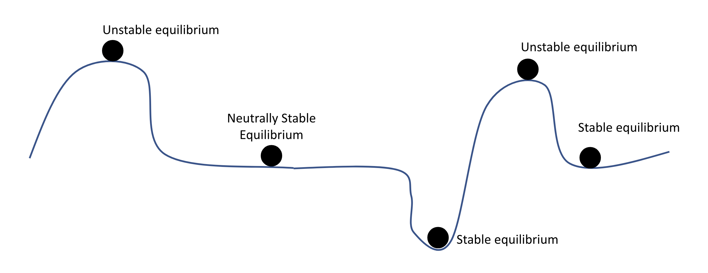
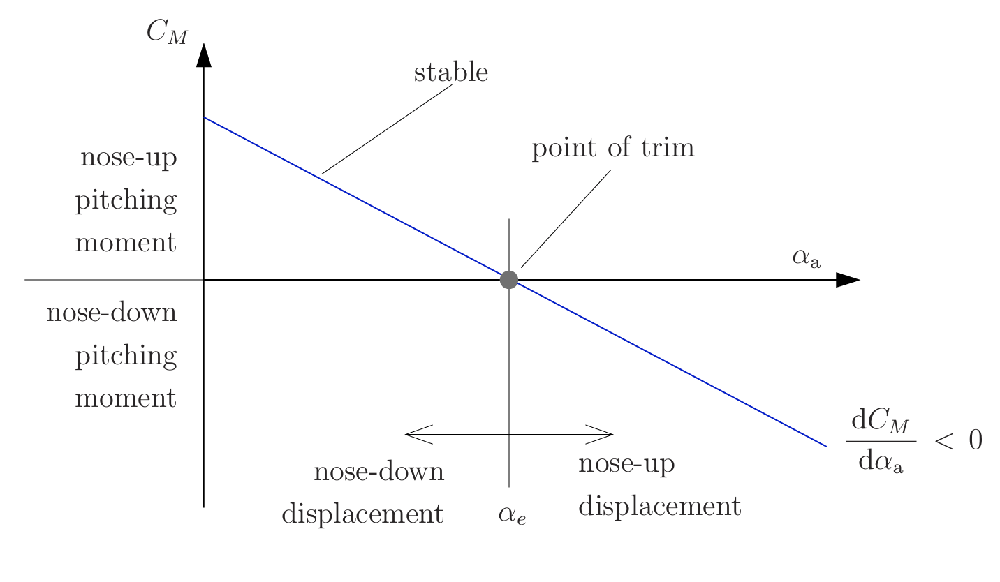
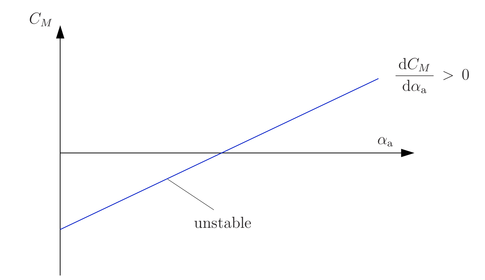

## Introduction

:::: {.columns}

::: {.column width="62%"}

::: {.r-stack}

::: {.fragment .fade-out fragment-index=1}
::: {.placeholder style="--ph-height: 440px;"}
[Image placeholder]{.placeholder-title}

Dr. Nick (The Simpsons): author to supply image file.

Removed on the first click.
:::
:::

::: {.fragment .fade-in fragment-index=1}
::: {.placeholder style="--ph-height: 440px;"}
[Animation placeholder: career map]{.placeholder-title}

Outline of the lower 48 US states. Each click adds:

1. [Flint, MI: **Kettering blue** star + Kettering University logo, *B.S. Mechanical Engineering* and *B.S. Electrical Engineering* underneath]{.fragment fragment-index=1}
2. [Arrow to Santa Cruz, CA: **UCSC banana-slug yellow** star + UC Santa Cruz logo, *Ph.D. Computer Engineering*, and under that "Robotics and Control"]{.fragment fragment-index=2}
3. [Tiny arrow to NASA Ames Research Center, Moffett Field, CA: **NASA blue** star + NASA Ames logo]{.fragment fragment-index=3}
4. [Tiny arrow to Fremont, CA: **Supernal green** star + Supernal logo]{.fragment fragment-index=4}
5. [Tiny arrow to Mountain View, CA: **Wisk yellow** star + Wisk logo]{.fragment fragment-index=5}

Logos: author to supply files.
:::
:::

:::

:::

::: {.column width="38%"}
::: {.placeholder style="--ph-height: 300px;"}
[QR code placeholder]{.placeholder-title}

Link to these slides; URL to be provided.
:::
:::

::::

## What are we covering today? {.smaller}

:::: {.columns}

::: {.column width="55%"}
"Have you ever made a paper air plane just pitch up then fall right to the ground when you throw it?"

::: {.fragment fragment-index=1}
::: {.placeholder style="--ph-height: 200px;"}
[Animation placeholder]{.placeholder-title}

Paper airplane is thrown, pitches up, stalls, and falls (inline SVG).
:::

"The cause might have been longitudinal static stability"
:::
:::

::: {.column width="45%"}
::: {.incremental}
- Review
- Longitudinal Forces
- Stability
- Longitudinal Static Stability
:::
:::

::::

## Review: Coordinate System {.interactive-slide}

::: {.interactive-wrap}
<iframe data-external="1" src="media/interactive/coordinate-system.html" title="Body axes: forces and moments"></iframe>
:::

<a class="interactive-open" href="media/interactive/coordinate-system.html" target="_blank" data-preview-link="false">Open full screen ↗</a>

## Review: Aerodynamic Angles {.interactive-slide}

::: {.interactive-wrap}
<iframe data-external="1" src="media/interactive/aerodynamic-angles.html" title="Aerodynamic angles: V, alpha, beta"></iframe>
:::

<a class="interactive-open" href="media/interactive/aerodynamic-angles.html" target="_blank" data-preview-link="false">Open full screen ↗</a>

## Wing Contribution to Longitudinal Forces {.smaller}

::: {.anim-frame style="--anim-height: 330px;"}
<iframe data-anim data-external="1" src="media/interactive/wing-buildup.html" title="Wing force build-up" tabindex="-1"></iframe>
:::

<!-- One invisible marker fragment per build step (1-8), so steps without a
     visible fragment of their own are not dropped by reveal.js. -->

::: {.r-stack .eq-stack}

::: {.fragment .fade-in fragment-index=4}
::: {.fragment .fade-out fragment-index=5}
$$M_{c.g.,w} = L(\alpha)\,d_{c.g.,L}$$
:::
:::

::: {.fragment .fade-in fragment-index=5}
::: {.fragment .fade-out fragment-index=6}
$$M_{c.g.,w} = L(\alpha)\,d_{c.g.,L} + D(\alpha)\,d_{c.g.,D}$$
:::
:::

::: {.fragment .fade-in fragment-index=6}
::: {.fragment .fade-out fragment-index=7}
$$M_{c.g.,w} = M_{ac}(\alpha) + L(\alpha)\,d_{c.g.,L} + D(\alpha)\,d_{c.g.,D}$$
:::
:::

::: {.fragment .fade-in fragment-index=7}
::: {.fragment .fade-out fragment-index=8}
$$M_{c.g.,w} = M_{ac}(\alpha) + L(\alpha)\,d_{c.g.,L} + D(\alpha)\,d_{c.g.,D} + T\,d_{c.g.,T}$$
:::
:::

::: {.fragment .fade-in fragment-index=8}
$$M_{c.g.,w} = M_{ac}(\alpha,\delta_f) + L(\alpha,\delta_f)\,d_{c.g.,L} + D(\alpha,\delta_f)\,d_{c.g.,D} + T\,d_{c.g.,T}$$
:::

:::

::: {.eq-where}
[$L$: lift vector; $d_{c.g.,L}$: orthogonal distance between the lift vector and the c.g.]{.fragment fragment-index=4}
[$D$: drag vector; $d_{c.g.,D}$: orthogonal distance between the drag vector and the c.g.]{.fragment fragment-index=5}
[$M_{ac}$: moment around the aerodynamic center of the wing]{.fragment fragment-index=6}
[$T$: thrust vector; $d_{c.g.,T}$: orthogonal distance between the thrust vector and the c.g.]{.fragment fragment-index=7}
[$\delta_f$: flap deflection]{.fragment fragment-index=8}
:::

## Tail Contribution to Longitudinal Forces {.smaller}

::: {.anim-frame style="--anim-height: 340px;"}
<iframe data-anim data-external="1" src="media/interactive/tail-buildup.html" title="Tail force build-up" tabindex="-1"></iframe>
:::

<!-- One invisible marker fragment per build step (1-3). -->

::: {.r-stack .eq-stack}

::: {.fragment .fade-in fragment-index=1}
::: {.fragment .fade-out fragment-index=2}
$$M_{c.g.,t} = L_t(\alpha)\,d_{c.g.,L_t}$$
:::
:::

::: {.fragment .fade-in fragment-index=2}
::: {.fragment .fade-out fragment-index=3}
$$M_{c.g.,t} = L_t(\alpha)\,d_{c.g.,L_t} + D_t(\alpha)\,d_{c.g.,D_t}$$
:::
:::

::: {.fragment .fade-in fragment-index=3}
$$M_{c.g.,t} = L_t(\alpha,\delta_e)\,d_{c.g.,L_t} + D_t(\alpha,\delta_e)\,d_{c.g.,D_t}$$
:::

:::

::: {.eq-where}
[$L_t$: tail lift vector; $d_{c.g.,L_t}$: orthogonal distance between the tail lift vector and the c.g.]{.fragment fragment-index=1}
[$D_t$: tail drag vector; $d_{c.g.,D_t}$: orthogonal distance between the tail drag vector and the c.g.]{.fragment fragment-index=2}
[$\delta_e$: elevator deflection]{.fragment fragment-index=3}
:::

## Calculating Total Pitching Moment {.smaller}

::: {.anim-frame style="--anim-height: 330px;"}
<iframe data-anim data-external="1" src="media/interactive/total-buildup.html" title="All wing and tail forces" tabindex="-1"></iframe>
:::

<!-- One invisible marker fragment per build step (1-2). -->

::: {.r-stack .eq-stack}

::: {.fragment .fade-out fragment-index=1}
$$M_{c.g.} = M_{c.g.,w} + M_{c.g.,t}$$
:::

::: {.fragment .fade-in fragment-index=1}
::: {.fragment .fade-out fragment-index=2}
$$M_{c.g.} = \underbrace{M_{ac}(\alpha,\delta_f) + L(\alpha,\delta_f)\,d_{c.g.,L} + D(\alpha,\delta_f)\,d_{c.g.,D} + T\,d_{c.g.,T}}_{M_{c.g.,w}} + M_{c.g.,t}$$
:::
:::

::: {.fragment .fade-in fragment-index=2}
$$
\begin{aligned}
M_{c.g.} = {} & \underbrace{M_{ac}(\alpha,\delta_f) + L(\alpha,\delta_f)\,d_{c.g.,L} + D(\alpha,\delta_f)\,d_{c.g.,D} + T\,d_{c.g.,T}}_{M_{c.g.,w}} \\
& + \underbrace{L_t(\alpha,\delta_e)\,d_{c.g.,L_t} + D_t(\alpha,\delta_e)\,d_{c.g.,D_t}}_{M_{c.g.,t}}
\end{aligned}
$$
:::

:::

## What happens if the forces are not balanced? {.interactive-slide}

::: {.interactive-wrap}
<iframe data-external="1" src="media/interactive/cg-simulator.html" title="Pitch about the C.G. simulator"></iframe>
:::

<a class="interactive-open" href="media/interactive/cg-simulator.html" target="_blank" data-preview-link="false">Open full screen ↗</a>

## What is stability?

Start with a system $\dot{x}(t) = f(x(t))$ that has a unique solution $x(t_0) = x_0$

::: {.fragment}
> **Equilibrium state:** A state $x_e$ is in equilibrium if $\dot{x}_e$ is zero in the absence of all inputs and disturbances.
:::

::: {.fragment}
which means, $f(x_e)=0, \ \forall\, t \geq t_0$
:::

## Stability

:::: {.columns}

::: {.column width="45%"}
A system is <u>**stable**</u> if it is perturbed from equilibrium and it returns back to equilibrium.
:::

::: {.column width="55%"}
::: {.placeholder style="--ph-height: 400px;"}
[Animation placeholder: stable pendulum]{.placeholder-title}

- Pendulum at rest, showing
  $\ddot{\theta} = -\frac{g}{L}\sin(\theta) - c\,\dot{\theta}$, $\ \theta = 0$
- Clip-art finger pokes the end of the pendulum
- Live $\theta$ readout; swings and returns to $\theta = 0$
:::
:::

::::

## Unstable Equilibrium

:::: {.columns}

::: {.column width="45%"}
**Unstable Equilibrium:** "An equilibrium that cannot return to the same equilibrium it was in when perturbed"
:::

::: {.column width="55%"}
::: {.placeholder style="--ph-height: 400px;"}
[Animation placeholder: inverted pendulum]{.placeholder-title}

- Same setup, starting inverted at $\theta = \pi$:
  $\ddot{\theta} = -\frac{g}{L}\sin(\theta) - c\,\dot{\theta}$
- Finger pokes it; it falls and comes to rest at $\theta = 0$
- At the end, an arrow points to the initial inverted position: "Can't make it back to here"
:::
:::

::::

## Neutral Equilibrium

::: {.placeholder style="--ph-height: 440px; --ph-img-height: 300px;"}
[Animation placeholder: equilibrium landscape shake]{.placeholder-title}

Neutral-stability picture is shaken. Unstable balls fall: one off the screen to the left, the other into the neighboring stable well. Stable balls return to where they started. The neutrally stable ball comes to rest just to the right of where it started.

:::

::: {.slide-footer-note}
Neutrally stable when after being perturbed it does not diverge.
:::

## What about Static Stability? {.smaller .dense-text}

While we presented the stability equations with time the concept can be applied to any variables.

For static stability we define its stability with reference to angle of attack $\alpha$ not time

So our function $\dot{x} = f(x(t))$ becomes

$$
\begin{aligned}
\frac{dM}{d\alpha} = {} & \frac{dM_{ac}(\alpha,\delta_f)}{d\alpha} + \frac{d\big[L(\alpha,\delta_f)\,d_{c.g.,L}\big]}{d\alpha} + \frac{d\big[D(\alpha,\delta_f)\,d_{c.g.,D}\big]}{d\alpha} \\
& + \frac{d\big[L_t(\alpha,\delta_e)\,d_{c.g.,L_t}\big]}{d\alpha} + \frac{d\big[D_t(\alpha,\delta_e)\,d_{c.g.,D_t}\big]}{d\alpha}
\end{aligned}
$$

An equilibrium point will be at any $\alpha$, $\delta_f$, $\delta_e$ combination where

$$M(\alpha, \delta_f, \delta_e) = 0$$

While we've defined everything there by the pitching moment $M$ it is more commonly defined as the pitching moment coefficient $C_M$

## Defining Static Stability

:::: {.columns}

::: {.column width="50%"}
::: {.placeholder style="--ph-height: 480px; --ph-img-height: 220px;"}
[Animation placeholder: pitch stable]{.placeholder-title}

$C_M$–$\alpha$ plot with negative slope. A dot moves along the line while the aircraft outline pitches up/down. A pitching-moment arrow changes direction and magnitude as the dot moves.

:::
:::

::: {.column width="50%"}
::: {.placeholder style="--ph-height: 480px; --ph-img-height: 220px;"}
[Animation placeholder: pitch unstable]{.placeholder-title}

$C_M$–$\alpha$ plot with positive slope, same animation. The moment arrow reinforces the displacement.

:::
:::

::::

## Longitudinal Trimming {.interactive-slide}

::: {.interactive-wrap}
<iframe data-external="1" src="media/interactive/trim-simulator.html" title="Longitudinal trimming with the elevator"></iframe>
:::

<a class="interactive-open" href="media/interactive/trim-simulator.html" target="_blank" data-preview-link="false">Open full screen ↗</a>

## Why does it matter? {.smaller}

Fundamental to aircraft safety. While not precisely a static equilibrium issue, the Boeing 737 MAX incidents were a close cousin.

::: {.placeholder style="--ph-height: 380px;"}
[Graphic placeholder: Boeing 737 MAX engine placement]{.placeholder-title}

- 737 NG vs. 737 MAX side by side: larger engines moved forward and up
- At high angles of attack the nacelles generate extra lift ahead of the C.G.
- That adds a nose-up pitching moment, which had to be compensated for
:::
